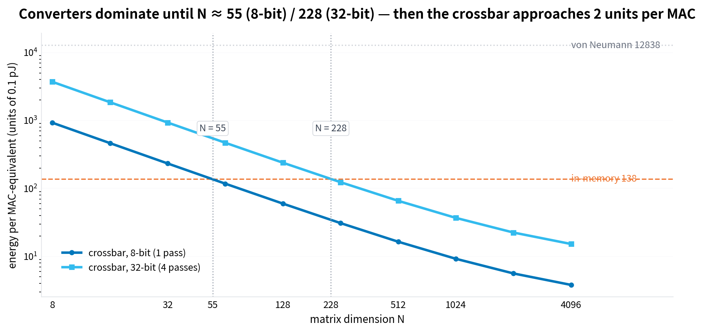
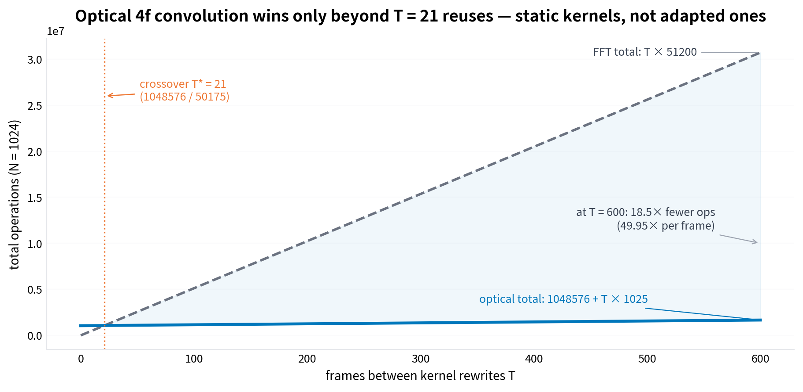
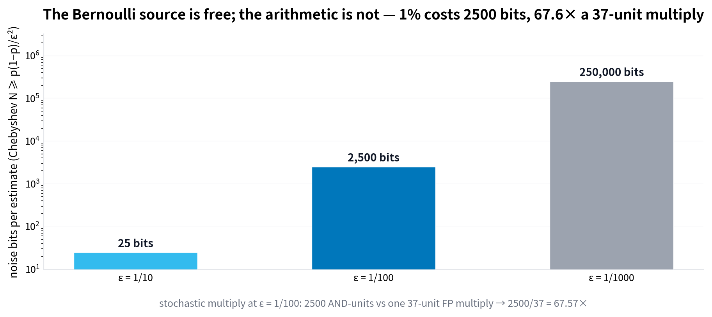
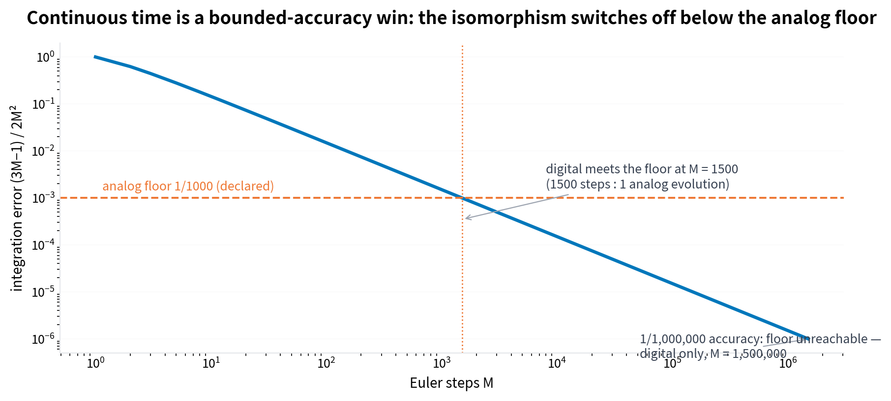

# Using the physical-isomorphisms crossovers — five workload decisions computed from a TCT output

**Companion artifact to** `case_studies/physical-isomorphisms-tct` (study 2.3,
"how can physical functions be mapped as isomorphisms to computational
systems, with measurable improvement") · **Date** 2026-11-01 · **Method**
every verdict below is computed exactly, in `Fraction`/`int`, from the case
study's re-verified premises — the TCT discipline carried into application
(`scripts/tct_applied_decisions.py`, log in `tct_applied/decisions.log`).

## 1. The test

The case study ends, like every TCT run, with measured constants and honest
caveats. This brief is the obvious next question: **can those outputs be
*used*?** Not quoted — used, the way an engineer uses a datasheet: enter the
workload parameters, get a verdict with its exact crossover location and its
caveat attached. The test below takes five concrete workload decisions, feeds
each through the case study's cost models, and reports what comes out. The
deliverables are this brief, the decision log, and a reusable instrument —
a self-contained HTML substrate selector whose verdict logic is
parity-tested against the Python engine (§9).

One framing note. The case study's constants are of two kinds, and the
verdicts inherit the distinction: **empirical premises** (the Horowitz 2014
energy table: 37-unit multiply, 50-unit SRAM read, 6400-unit DRAM read) and
**declared illustrative model values** (crossbar cell = 2 units, converter =
3700 units, analog floor = 1/1000). The Lean tier of the study records
exactly this split — six axioms, three sorry lemmas. Decisions computed from
axioms are decisions about the *model*; they are as strong as the model, and
no stronger. That inheritance is itself part of what "using a TCT output"
means: the epistemic hygiene ships with the numbers.

## 2. The premises used

All six Column-3 scripts of the case study were re-run live on 2026-11-01
before any decision was computed (`tct_applied/reverification.log`); every
headline constant reproduced exactly.

| Premise | Value | Source | Status |
|---|---|---|---|
| Per-MAC energy, von Neumann | 12838 units (0.1 pJ) | script 01 | empirical (Horowitz 2014) |
| Per-MAC energy, in-memory | 138 units | script 01 | empirical (Horowitz 2014) |
| Crossbar cell / converter | 2 / 3700 units | script 01 | illustrative (axiom) |
| Optical 4f: setup / per-frame | 1048576 / 1025 ops | script 02 | illustrative (axiom) |
| FFT per frame (N=1024) | 51200 ops | script 02 | derived, exact |
| Chebyshev stream length | N ≥ p(1−p)/ε² | script 03 | theorem (carried) |
| AND gate vs FP multiply | 1 vs 37 units | script 03 | empirical |
| Analog error floor | 1/1000 | script 04 | illustrative (axiom) |
| Euler error | e_M = (3M−1)/2M² | script 04 | derived, exact |
| SAT→Ising mapping | exact, 8/8 assignments | script 06 | derived, exact |
| Extended Church–Turing | — | script 06 / ledger | axiom (`physical_church_turing`) |

The Lean ledger of the study scans, as before, **3 sorry** (`break_even_symbolic`,
`euler_error_general`, `stochastic_n_required`) and **6 axioms** — the
development the study still owes and the premises it honestly assumes,
unchanged by this brief.

## 3. Decision A — an edge-inference matmul engine (N = 1024)

**Question.** A 1024×1024 matrix–vector engine for edge inference: does an
analog crossbar beat digital, and by how much, at 8-bit and at 32-bit
effective precision?

**Computation.** Analog total = P·(2N² + 7400N) with P = bits/8 passes;
digital totals are 138·N² (in-memory) and 12838·N² (von Neumann). At N = 1024:

| Precision | Analog total | vs in-memory | vs von Neumann |
|---|---|---|---|
| 8-bit (1 pass) | 9,674,752 units | 17664/1181 ≈ **14.96×** fewer | 1643264/1181 ≈ **1391.42×** fewer |
| 32-bit (4 passes) | 38,699,008 units | 4416/1181 ≈ **3.74×** fewer | 410816/1181 ≈ **347.85×** fewer |

**Verdict.** The crossbar wins at N = 1024 under every comparison, but the
*margin collapses with precision*: bit-slicing to 32 bits (four passes)
eats four× the converter overhead and shrinks a 15× win to 3.7× against
in-memory digital. The asymptotic 69× is the converter-free limit and is
never reached at practical N.

**Location and caveat.** The break-even against in-memory digital sits at
N > 2960/13, i.e. N ≥ 228 for 32-bit and N ≥ 55 for 8-bit — N = 1024
clears both (Fig. 1). Below those sizes the converters eat the compute:
this is precondition P4 (I/O discipline) of the study, now with a number
attached. Constants illustrative; the verdict is about the model.

## 4. Decision B — a real-time convolution pipeline (fixed kernel, 60 fps)

**Question.** A 4K-class pipeline convolving each frame with a kernel that is
re-trained every 10 seconds — 600 frames between rewrites. Optical 4f
correlator or digital FFT?

**Computation.** Optical total = 1048576 + T·1025; FFT total = T·51200. At
T = 600: optical 1,663,576 ops versus FFT 30,720,000 ops — a ratio of
3840000/207947 ≈ **18.47× fewer total operations**, and 2048/41 ≈
**49.95× per frame**. The counter-case matters as much: with a filter
*adapted every frame* (T = 1), optical costs 1,049,601 ops versus 51,200 —
**20.50× more**, because the N² kernel-programming setup never amortizes.

**Verdict.** Optical, decisively — for this reuse pattern. The crossover is
T* = ceil(1048576/50175) = **21** reuses (Fig. 2): a kernel rewritten more
often than every 21 frames flips the verdict to digital.

**Location and caveat.** The gain is *amortization* (precondition P2), not
raw compute: the per-frame 49.95× is real only while the kernel is static.
Any workload with per-frame adaptation is on the wrong side of the
crossover, and the instrument below says so explicitly.

## 5. Decision C — Monte-Carlo estimates at 1% error

**Question.** Simulations need millions of Bernoulli samples at 1% error.
Is a physical noise source useful here?

**Computation.** Chebyshev stream length N ≥ p(1−p)/ε² at p = 1/2, by
closed form and enumeration, both paths agreeing: **25 bits** at ε = 1/10,
**2500 bits** at ε = 1/100, **250000 bits** at ε = 1/1000 (Fig. 4). The
arithmetic trade: one stochastic multiply at 1% error costs 2500
AND-gate-units against one 37-unit FP multiply — **2500/37 ≈ 67.57× more
energy per multiply**.

**Verdict.** Yes, as a *randomness source*; no, as an *arithmetic engine*.
The noise stream is free where a digital PRNG costs generator state and
rounding discipline — that is gain G4 of the study. But bit-serial
stochastic arithmetic pays 67.6× per multiply at this tolerance, so the
samples should be *taken* from physics and *summed* digitally.

**Location and caveat.** The crossover width (11 bits, script 03) bounds
when stochastic encoding even represents the operands. And the verdict
inherits the bound's pessimism: the exact binomial tail at N = 100 is
far below the Chebyshev 1/4, so 2500 bits is a floor, not an estimate.

## 6. Decision D — an analog co-processor for ODE integration

**Question.** A thermal-simulation loop needs y' = f(y,t) integrated to a
declared accuracy. When does one analog evolution beat digital Euler?

**Computation.** Euler's error is exactly (3M−1)/2M² (verified against the
direct sum for M = 1..20 in the study, re-run here). Digital reaches the
analog floor 1/1000 at **M = 1500** steps — the study's 1500:1 step ratio.
Push the demand to 1/1,000,000 and digital needs **M = 1,500,000** steps —
but the analog floor *cannot follow*: 1/1000 > 10⁻⁶, so no number of analog
evolutions reaches the target accuracy (Fig. 3).

**Verdict.** Match the floor. At 1/10³-class accuracy the analog
co-processor is the full 1500:1 win the study measured; at 1/10⁶-class it
is inadmissible, regardless of speed. Continuous time (gain G2) is a
**bounded-accuracy** win, and the bound is a declared model axiom, not a
measured constant — a deployment would measure its own floor first.

## 7. Decision E — "should we buy an Ising annealer for our SAT workload?"

**Question.** The sales claim: map SAT to Ising energy and let physics find
the satisfying assignment asymptotically faster.

**Computation.** None — and that *is* the answer. The study's mapping is
exact (`EQUIVALENCE = 1` on all 8 assignments of its witness instance), and
its overhead is measured (16 gadget slots, 6 surviving cubic terms — the
tax quadratic-only hardware pays). But exactness of encoding is not speedup:
the 2ⁿ search space maps onto 2ⁿ energy evaluations, and the extended
Church–Turing thesis stands in the study's ledger as an **axiom**, with the
quantum case explicitly open and unclaimed.

**Verdict.** `WOULD_BE_GUESS` — refused, with the refusal inherited directly
from the study's guardrail G-table: "Ising machines solve NP-hard problems"
is rephrased to *heuristics with parallel search; no class claim*. What the
isomorphism does license is measurable: massively parallel energy
evaluation (a constant-factor story) and an exact encoding whose overhead
you can budget. A purchase decision can rest on those; a complexity claim
cannot.

## 8. What using the output bought

| Decision | Verdict | Exact location | Inherited caveat |
|---|---|---|---|
| A — matmul engine | crossbar, 3.7× @ 32-bit | N ≥ 228 (32-bit) / 55 (8-bit) | converter + model axioms |
| B — convolution pipeline | optical, 18.5× total / 50× per frame | T* = 21 reuses | static kernels only |
| C — Monte-Carlo samples | noise as source, not arithmetic | 2500 bits @ 1%; 67.6× per multiply | Chebyshev pessimism |
| D — ODE co-processor | analog at 1/10³, digital at 1/10⁶ | M = 1500; floor 1/1000 | floor is an axiom |
| E — Ising annealer | refused (`WOULD_BE_GUESS`) | ECT axiom; 6 cubic terms | quantum open |

Three things emerged that the headline numbers alone do not give. First,
**the margins are precision- and reuse-conditional**: 15× collapses to 3.7×
between 8 and 32 bits; 50× per frame inverts to 20.5× *worse* when the
kernel adapts per frame. Second, **two of the five verdicts are refusals or
switch-offs** — the same instrument that says "yes, 18.5×" also says "no,
not at that accuracy" and "no, that would be a guess", exactly the guardrail
behaviour the study's table demanded. Third, **every number is
reproducible**: the premises re-verified live before use, the decisions
re-derivable from one script, the instrument parity-tested (§9).

## 9. The instrument — a substrate selector you can operate

The verdicts above are packaged as `tct_substrate_selector.html` — a single
self-contained static page (inline CSS/JS, no build, no network) that runs
the same five decisions interactively. Its discipline is inherited from the
source study: **all comparisons are computed in integers** (cross-multiplied
rational comparisons in JS), floats appear only in clearly-labelled display
strings, and the Ising panel answers a "we expect exponential speedup"
selection with the ECT-guardrail refusal rather than a number. The page also
carries the premise table with each constant's empirical/illustrative
status, so a user cannot quote a verdict without its caveat attached.

**Parity test.** The page's decision functions were extracted and executed
under Node on 45 parameter sets spanning all five panels; every verdict,
ratio and crossover matches `scripts/tct_applied_decisions.py` exactly
(log: `tct_applied/parity.log`). The instrument is the Python engine, not a
re-implementation that happens to agree.

## 10. Conclusions

The test succeeds, with a precise sense of "use". The case study's outputs —
cost models, crossover formulas, guardrails, and their axiom/empirical split —
function as a *decision datasheet*: five workload questions went in, five
verdicts came out, each with its exact crossover location and inherited
caveat, and nothing was claimed beyond the premises. The one general lesson:
a TCT output is *operational* exactly where it is *honest* — the break-evens
and the refusals are the same numbers, and an instrument built from them
inherits both.
